

  &nbsp;
  <a href="https://www.threads.com/@malilion.dev"><picture><source media="(prefers-color-scheme: dark)" srcset="https://cdn.simpleicons.org/threads/F1EDE6"></picture></a>&nbsp;
  <a href="https://github.com/malilion?tab=repositories"><picture><source media="(prefers-color-scheme: dark)" srcset="https://cdn.simpleicons.org/github/F1EDE6"></picture></a>&nbsp;
  <a href="https://www.npmjs.com/package/@malilion/ui"><picture><source media="(prefers-color-scheme: dark)" srcset="https://cdn.simpleicons.org/npm/CB3837"></picture></a>
  &nbsp;&nbsp;|&nbsp;&nbsp;
  <a href="https://github.com/malilion/malilion/blob/main/README.md">English</a> · <a href="https://github.com/malilion/malilion/blob/main/README.zh-TW.md">繁體中文</a>

<a href="https://malilion.com"><picture><source media="(max-width: 600px) and (prefers-color-scheme: dark)" srcset="./assets/brand/bento/hero-m-en-dark.svg"><source media="(max-width: 600px)" srcset="./assets/brand/bento/hero-m-en-light.svg"><source media="(prefers-color-scheme: dark)" srcset="./assets/brand/bento/hero-en-dark.svg"></picture></a> 
<picture><source media="(max-width: 600px) and (prefers-color-scheme: dark)" srcset="./assets/brand/bento/ticker-m-en-dark.svg"><source media="(max-width: 600px)" srcset="./assets/brand/bento/ticker-m-en-light.svg"><source media="(prefers-color-scheme: dark)" srcset="./assets/brand/bento/ticker-en-dark.svg">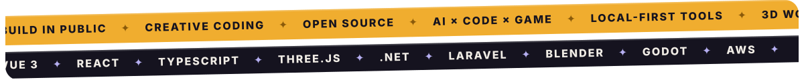</picture> 
<a href="https://malilion.github.io/MalilionUI/"><picture><source media="(max-width: 600px) and (prefers-color-scheme: dark)" srcset="./assets/brand/bento/malilion-ui-m-en-dark.svg"><source media="(max-width: 600px)" srcset="./assets/brand/bento/malilion-ui-m-en-light.svg"><source media="(prefers-color-scheme: dark)" srcset="./assets/brand/bento/malilion-ui-en-dark.svg"></picture></a><!--
--><a href="https://www.malilion.com/world"><picture><source media="(max-width: 600px) and (prefers-color-scheme: dark)" srcset="./assets/brand/bento/project-island-m-en-dark.svg"><source media="(max-width: 600px)" srcset="./assets/brand/bento/project-island-m-en-light.svg"><source media="(prefers-color-scheme: dark)" srcset="./assets/brand/bento/project-island-en-dark.svg"></picture></a> 
<a href="https://github.com/malilion/ContextLion"><picture><source media="(max-width: 600px) and (prefers-color-scheme: dark)" srcset="./assets/brand/bento/contextlion-m-en-dark.svg"><source media="(max-width: 600px)" srcset="./assets/brand/bento/contextlion-m-en-light.svg"><source media="(prefers-color-scheme: dark)" srcset="./assets/brand/bento/contextlion-en-dark.svg">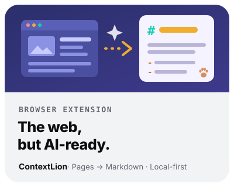</picture></a><!--
--><a href="https://ithelp.ithome.com.tw/users/20183394/ironman/9059"><picture><source media="(max-width: 600px) and (prefers-color-scheme: dark)" srcset="./assets/brand/bento/ninefold-court-m-en-dark.svg"><source media="(max-width: 600px)" srcset="./assets/brand/bento/ninefold-court-m-en-light.svg"><source media="(prefers-color-scheme: dark)" srcset="./assets/brand/bento/ninefold-court-en-dark.svg"></picture></a><!--
--><a href="https://github.com/malilion/cow-pasture"><picture><source media="(max-width: 600px) and (prefers-color-scheme: dark)" srcset="./assets/brand/bento/cow-pasture-m-en-dark.svg"><source media="(max-width: 600px)" srcset="./assets/brand/bento/cow-pasture-m-en-light.svg"><source media="(prefers-color-scheme: dark)" srcset="./assets/brand/bento/cow-pasture-en-dark.svg"></picture></a> 
<a href="https://malilion.com"><picture><source media="(max-width: 600px) and (prefers-color-scheme: dark)" srcset="./assets/brand/bento/now-building-m-en-dark.svg"><source media="(max-width: 600px)" srcset="./assets/brand/bento/now-building-m-en-light.svg"><source media="(prefers-color-scheme: dark)" srcset="./assets/brand/bento/now-building-en-dark.svg">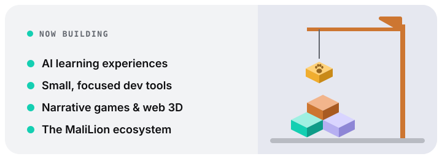</picture></a><!--
--><a href="https://www.threads.com/@malilion.dev"><picture><source media="(max-width: 600px) and (prefers-color-scheme: dark)" srcset="./assets/brand/bento/threads-m-en-dark.svg"><source media="(max-width: 600px)" srcset="./assets/brand/bento/threads-m-en-light.svg"><source media="(prefers-color-scheme: dark)" srcset="./assets/brand/bento/threads-en-dark.svg">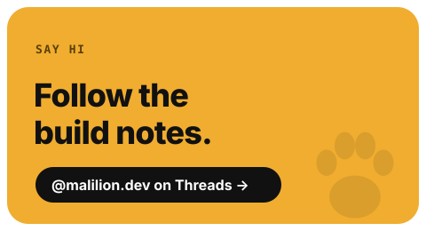</picture></a>

  
  
  
   
  <a href="https://malilion.github.io/MalilionUI/"><b>Malilion UI docs</b></a> · <a href="https://www.youtube.com/watch?v=ElXvObJbIFY"><b>Trailer</b></a> · <a href="https://malilion.com"><b>malilion.com</b></a> · <a href="https://www.threads.com/@malilion.dev"><b>Threads</b></a>

## Everything else

<table>
<tr>
<td width="50%" valign="top">
<picture><source media="(prefers-color-scheme: dark)" srcset="./assets/brand/bento/cat-ai-tools-en-dark.svg">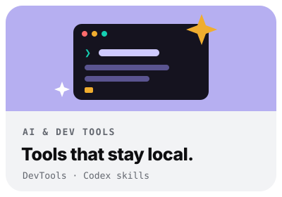</picture>  
<a href="https://github.com/malilion/AURA-REC"><b>AURA REC</b></a> · <a href="https://malilion.github.io/AURA-REC/">↗ Site</a> Free, privacy-first screen recorder and tutorial editor for macOS, Windows and the browser  
<a href="https://github.com/malilion/StockLion"><b>StockLion 股力獅</b></a> Browser extension: Taiwan stock quotes and watchlists on any page  
<a href="https://github.com/malilion/Malilion-AI-Radar"><b>Malilion AI Radar</b></a> · <a href="https://malilion.github.io/Malilion-AI-Radar/">↗ Site</a> Hourly news and AI intelligence site, built and updated automatically  
<a href="https://github.com/malilion/DevTraceLion"><b>DevTrace Lion</b></a> Local-first API debugging inside DevTools, zero permissions  
<a href="https://github.com/malilion/github-repo-landing-page-skill"><b>GitHub Repo Landing Page Skill</b></a> · <a href="https://malilion.github.io/github-repo-landing-page-skill/">↗ Site</a> Agent skill that turns any GitHub repo into a landing page  
<a href="https://github.com/malilion/editorial-photo-poster"><b>Editorial Photo Poster</b></a> · <a href="https://github.com/malilion/haute-jewelry-from-photo"><b>Haute Jewelry From Photo</b></a> · <a href="https://github.com/malilion/scenic-bookmark-travel-poster"><b>Scenic Bookmark Travel Poster</b></a> Codex skills: photos into posters, jewelry concepts and bookmarks  
</td>
<td width="50%" valign="top">
<picture><source media="(prefers-color-scheme: dark)" srcset="./assets/brand/bento/cat-games-en-dark.svg">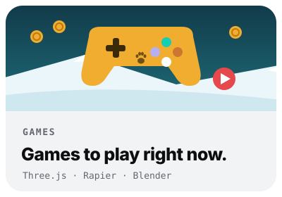</picture>  
<a href="https://github.com/malilion/Snowboarding"><b>POWDER RUSH 粉雪狂飆</b></a> · <a href="https://malilion.github.io/Snowboarding/">▶ Play</a> 3D snowboarding: 3,200 m run, 18 kickers, tricks and gates  
<a href="https://github.com/malilion/neon-taipei-overdrive"><b>Neon Taipei Overdrive</b></a> · <a href="https://malilion.github.io/neon-taipei-overdrive/">▶ Play</a> Cyberpunk action on a rainy Taipei night, in one HTML file  
<a href="https://github.com/malilion/shuangyue-wenjian"><b>霜月問劍</b></a> · <a href="https://malilion.github.io/shuangyue-wenjian/">▶ Play</a> Top-down wuxia action: three stages, two-phase bosses  
<a href="https://github.com/malilion/prachute"><b>Cloud Dive 雲海跳傘</b></a> · <a href="https://malilion.github.io/prachute/">▶ Play</a> Skydive from 4,000 m through golden clouds onto the target  
<a href="https://github.com/malilion/star-garden-rumble"><b>Star Garden Rumble</b></a> · <a href="https://malilion.github.io/star-garden-rumble/">▶ Play</a> Low-poly physics defence on a floating island (Rapier)  
<a href="https://github.com/malilion/Polar-Bear-BBQ-Game"><b>Polar Bear BBQ 3D</b></a> · <a href="https://malilion.github.io/Polar-Bear-BBQ-Game/">▶ Play</a> A grill-shop game modelled in Blender, played in Three.js  
</td>
</tr>
<tr>
<td width="50%" valign="top">
<picture><source media="(prefers-color-scheme: dark)" srcset="./assets/brand/bento/cat-worlds-en-dark.svg"></picture>  
<a href="https://github.com/malilion/The-Nocturne-Atlas"><b>The Nocturne Atlas</b></a> Seed-driven 3D wizarding world, Three.js + TypeScript  
<a href="https://github.com/malilion/Painterly-Meadow"><b>Painterly Meadow</b></a> Hand-painted NPR nature sandbox in one Three.js file  
<a href="https://github.com/malilion/fuji-sakura-vista"><b>Fuji Sakura Vista</b></a> Procedural Blender scene of Fuji at dawn, with a Three.js showcase  
<a href="https://github.com/malilion/bee_scene"><b>Realistic Bee & Flowers</b></a> · <a href="https://malilion.github.io/bee_scene/">↗ Site</a> A honeybee foraging a meadow, in one offline HTML file  
</td>
<td width="50%" valign="top">
<picture><source media="(prefers-color-scheme: dark)" srcset="./assets/brand/bento/cat-creative-en-dark.svg"></picture>  
<a href="https://malilion.github.io/BlockUI/"><b>BlockUI</b></a> Pixel-crafting React UI, five themes, WCAG 2.2 AA  
<a href="https://github.com/malilion/my-bear-jelly"><b>Gummy/Bears.</b></a> · <a href="https://malilion.github.io/my-bear-jelly/">↗ Site</a> Wobbly gummy bears, every pixel raymarched in one shader  
<a href="https://github.com/malilion/lyricreel"><b>lyricreel</b></a> Song + lyrics in, beat-synced lyric video out  
<a href="https://github.com/malilion/riso-mv-kit"><b>riso-mv-kit</b></a> Riso-print picture-book music videos drawn in code  
<a href="https://github.com/malilion/oledfx"><b>oledfx</b></a> · <a href="https://github.com/malilion/inkfx"><b>inkfx</b></a> · <a href="https://github.com/malilion/fx-skill-kit"><b>fx-skill-kit</b></a> Procedural FX kits for code-drawn effects  
</td>
</tr>
</table>

<a href="https://github.com/malilion?tab=repositories"><b>View all repositories →</b></a> · <a href="https://malilion.com"><b>More on malilion.com →</b></a>

## Stack

<picture><source media="(prefers-color-scheme: dark)" srcset="./assets/brand/bento/stack-core-en-dark.svg"></picture><!--
--><picture><source media="(prefers-color-scheme: dark)" srcset="https://skillicons.dev/icons?i=html%2Ccss%2Cjs%2Cts%2Cphp%2Ccs%2Cdotnet&theme=dark"></picture> 
<picture><source media="(prefers-color-scheme: dark)" srcset="./assets/brand/bento/stack-frontend-en-dark.svg"></picture><!--
--><picture><source media="(prefers-color-scheme: dark)" srcset="https://skillicons.dev/icons?i=laravel%2Cvue%2Creact%2Cnextjs%2Cvite%2Cpinia%2Ctailwind&theme=dark"></picture> 
<picture><source media="(prefers-color-scheme: dark)" srcset="./assets/brand/bento/stack-cloud-en-dark.svg"></picture><!--
--><picture><source media="(prefers-color-scheme: dark)" srcset="https://skillicons.dev/icons?i=aws%2Cdocker%2Cvercel%2Ccloudflare%2Csupabase%2Cpostgres%2Cmysql&theme=dark"></picture> 
<picture><source media="(prefers-color-scheme: dark)" srcset="./assets/brand/bento/stack-tools-en-dark.svg"></picture><!--
--><picture><source media="(prefers-color-scheme: dark)" srcset="https://skillicons.dev/icons?i=git%2Cgithub%2Cgitlab%2Cpnpm%2Cobsidian%2Cthreejs%2Cgodot&theme=dark"></picture>

## Experience

<picture><source media="(max-width: 600px) and (prefers-color-scheme: dark)" srcset="./assets/brand/bento/experience-m-en-dark.svg"><source media="(max-width: 600px)" srcset="./assets/brand/bento/experience-m-en-light.svg"><source media="(prefers-color-scheme: dark)" srcset="./assets/brand/bento/experience-en-dark.svg">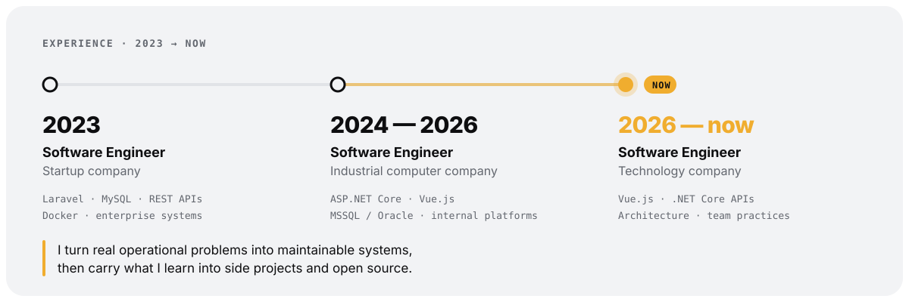</picture> 
<picture><source media="(max-width: 600px) and (prefers-color-scheme: dark)" srcset="./assets/brand/bento/certifications-m-en-dark.svg"><source media="(max-width: 600px)" srcset="./assets/brand/bento/certifications-m-en-light.svg"><source media="(prefers-color-scheme: dark)" srcset="./assets/brand/bento/certifications-en-dark.svg">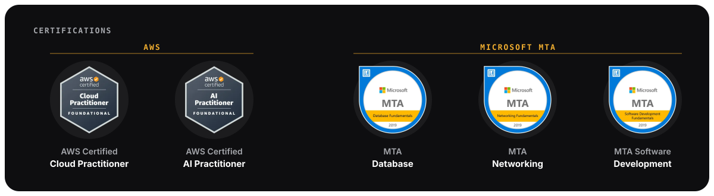</picture>

## Activity

<picture><source media="(max-width: 600px) and (prefers-color-scheme: dark)" srcset="https://raw.githubusercontent.com/malilion/malilion/gh-pages/activity-year-m-dark.svg"><source media="(max-width: 600px)" srcset="https://raw.githubusercontent.com/malilion/malilion/gh-pages/activity-year-m-light.svg"><source media="(prefers-color-scheme: dark)" srcset="https://raw.githubusercontent.com/malilion/malilion/gh-pages/activity-year-dark.svg"></picture><!--
--><picture><source media="(max-width: 600px) and (prefers-color-scheme: dark)" srcset="https://raw.githubusercontent.com/malilion/malilion/gh-pages/activity-streak-m-dark.svg"><source media="(max-width: 600px)" srcset="https://raw.githubusercontent.com/malilion/malilion/gh-pages/activity-streak-m-light.svg"><source media="(prefers-color-scheme: dark)" srcset="https://raw.githubusercontent.com/malilion/malilion/gh-pages/activity-streak-dark.svg"></picture><!--
--><picture><source media="(max-width: 600px) and (prefers-color-scheme: dark)" srcset="https://raw.githubusercontent.com/malilion/malilion/gh-pages/activity-languages-m-dark.svg"><source media="(max-width: 600px)" srcset="https://raw.githubusercontent.com/malilion/malilion/gh-pages/activity-languages-m-light.svg"><source media="(prefers-color-scheme: dark)" srcset="https://raw.githubusercontent.com/malilion/malilion/gh-pages/activity-languages-dark.svg">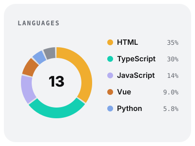</picture><!--
--><picture><source media="(max-width: 600px) and (prefers-color-scheme: dark)" srcset="https://raw.githubusercontent.com/malilion/malilion/gh-pages/activity-numbers-m-dark.svg"><source media="(max-width: 600px)" srcset="https://raw.githubusercontent.com/malilion/malilion/gh-pages/activity-numbers-m-light.svg"><source media="(prefers-color-scheme: dark)" srcset="https://raw.githubusercontent.com/malilion/malilion/gh-pages/activity-numbers-dark.svg"></picture>

  <picture>
    <source media="(prefers-color-scheme: dark)" srcset="https://raw.githubusercontent.com/malilion/malilion/gh-pages/paw-heatmap-dark.svg">
    <source media="(prefers-color-scheme: light)" srcset="https://raw.githubusercontent.com/malilion/malilion/gh-pages/paw-heatmap-light.svg">
    
  </picture>

<a href="https://malilion.com"><picture><source media="(max-width: 600px) and (prefers-color-scheme: dark)" srcset="./assets/brand/bento/footer-m-en-dark.svg"><source media="(max-width: 600px)" srcset="./assets/brand/bento/footer-m-en-light.svg"><source media="(prefers-color-scheme: dark)" srcset="./assets/brand/bento/footer-en-dark.svg"></picture></a>

