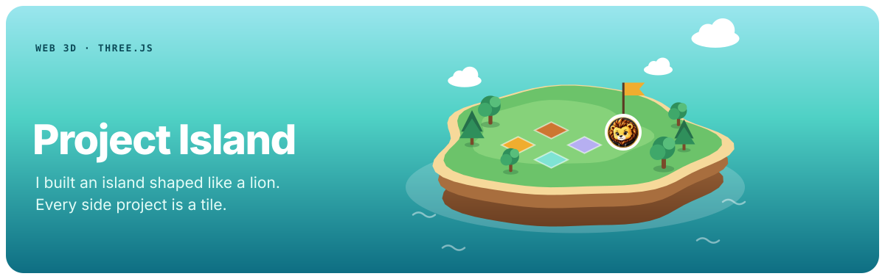
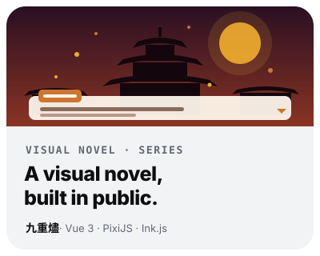
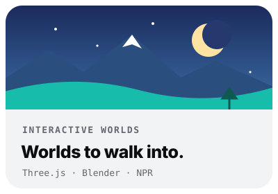
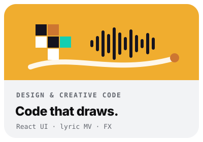
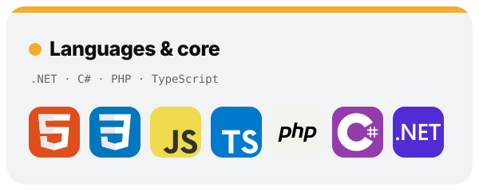
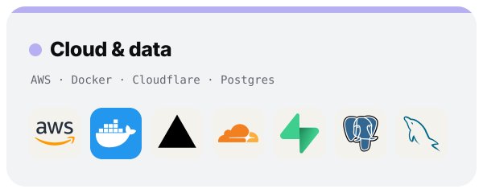
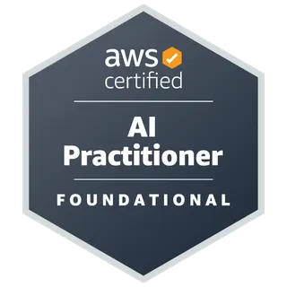

  <a href="https://github.com/malilion/malilion/blob/main/README.md">English</a> · <a href="https://github.com/malilion/malilion/blob/main/README.zh-TW.md">繁體中文</a>

<a href="https://malilion.com"><picture><source media="(prefers-color-scheme: dark)" srcset="./assets/brand/bento/hero-en-dark.svg"></picture></a> 
<picture><source media="(prefers-color-scheme: dark)" srcset="./assets/brand/bento/ticker-en-dark.svg"></picture> 
<a href="https://malilion.github.io/MalilionUI/"><picture><source media="(prefers-color-scheme: dark)" srcset="./assets/brand/bento/malilion-ui-en-dark.svg"></picture></a><!--
--><a href="https://www.malilion.com/world"><picture><source media="(prefers-color-scheme: dark)" srcset="./assets/brand/bento/project-island-en-dark.svg"></picture></a> 
<a href="https://github.com/malilion/ContextLion"><picture><source media="(prefers-color-scheme: dark)" srcset="./assets/brand/bento/contextlion-en-dark.svg"></picture></a><!--
--><a href="https://ithelp.ithome.com.tw/users/20183394/ironman/9059"><picture><source media="(prefers-color-scheme: dark)" srcset="./assets/brand/bento/ninefold-court-en-dark.svg"></picture></a><!--
--><a href="https://github.com/malilion/cow-pasture"><picture><source media="(prefers-color-scheme: dark)" srcset="./assets/brand/bento/cow-pasture-en-dark.svg"></picture></a> 
<a href="https://malilion.com"><picture><source media="(prefers-color-scheme: dark)" srcset="./assets/brand/bento/now-building-en-dark.svg"></picture></a><!--
--><a href="https://www.threads.com/@malilion.dev"><picture><source media="(prefers-color-scheme: dark)" srcset="./assets/brand/bento/threads-en-dark.svg"></picture></a>

  
  
  
   
  <a href="https://malilion.github.io/MalilionUI/"><b>Malilion UI docs</b></a> · <a href="https://www.youtube.com/watch?v=ElXvObJbIFY"><b>Trailer</b></a> · <a href="https://malilion.com"><b>malilion.com</b></a> · <a href="https://www.threads.com/@malilion.dev"><b>Threads</b></a>

## Everything else

<table>
<tr>
<td width="33%" valign="top">
<picture><source media="(prefers-color-scheme: dark)" srcset="./assets/brand/bento/cat-ai-tools-en-dark.svg"></picture>  
<a href="https://github.com/malilion/DevTraceLion"><b>DevTrace Lion</b></a> Local-first API debugging inside DevTools, zero permissions  
<a href="https://github.com/malilion/editorial-photo-poster"><b>Editorial Photo Poster</b></a> Codex skill: photos into restrained editorial posters  
<a href="https://github.com/malilion/haute-jewelry-from-photo"><b>Haute Jewelry From Photo</b></a> Codex skill: visual mood into haute joaillerie concepts  
<a href="https://github.com/malilion/scenic-bookmark-travel-poster"><b>Scenic Bookmark Travel Poster</b></a> Codex skill: travel photos into souvenir posters  
</td>
<td width="33%" valign="top">
<picture><source media="(prefers-color-scheme: dark)" srcset="./assets/brand/bento/cat-worlds-en-dark.svg"></picture>  
<a href="https://github.com/malilion/The-Nocturne-Atlas"><b>The Nocturne Atlas</b></a> Seed-driven 3D wizarding world, Three.js + TypeScript  
<a href="https://github.com/malilion/Painterly-Meadow"><b>Painterly Meadow</b></a> Hand-painted NPR nature sandbox in one Three.js file  
<a href="https://github.com/malilion/fuji-sakura-vista"><b>Fuji Sakura Vista</b></a> Procedural Blender scene of Fuji at dawn, with a Three.js showcase  
</td>
<td width="33%" valign="top">
<picture><source media="(prefers-color-scheme: dark)" srcset="./assets/brand/bento/cat-creative-en-dark.svg"></picture>  
<a href="https://malilion.github.io/BlockUI/"><b>BlockUI</b></a> Pixel-crafting React UI, five themes, WCAG 2.2 AA  
<a href="https://github.com/malilion/lyricreel"><b>lyricreel</b></a> Song + lyrics in, beat-synced lyric video out  
<a href="https://github.com/malilion/riso-mv-kit"><b>riso-mv-kit</b></a> Riso-print picture-book music videos drawn in code  
<a href="https://github.com/malilion/oledfx"><b>oledfx</b></a> · <a href="https://github.com/malilion/inkfx"><b>inkfx</b></a> · <a href="https://github.com/malilion/fx-skill-kit"><b>fx-skill-kit</b></a> Procedural FX kits for code-drawn effects  
</td>
</tr>
</table>

<a href="https://github.com/malilion?tab=repositories"><b>View all repositories →</b></a> · <a href="https://malilion.com"><b>More on malilion.com →</b></a>

## Stack

<picture><source media="(prefers-color-scheme: dark)" srcset="./assets/brand/bento/stack-core-en-dark.svg"></picture><!--
--><picture><source media="(prefers-color-scheme: dark)" srcset="https://skillicons.dev/icons?i=html,css,js,ts,php,cs,dotnet"></picture> 
<picture><source media="(prefers-color-scheme: dark)" srcset="./assets/brand/bento/stack-frontend-en-dark.svg"></picture><!--
--><picture><source media="(prefers-color-scheme: dark)" srcset="https://skillicons.dev/icons?i=laravel,vue,react,nextjs,vite,pinia,tailwind"></picture> 
<picture><source media="(prefers-color-scheme: dark)" srcset="./assets/brand/bento/stack-cloud-en-dark.svg"></picture><!--
--><picture><source media="(prefers-color-scheme: dark)" srcset="https://skillicons.dev/icons?i=aws,docker,vercel,cloudflare,supabase,postgres,mysql"></picture> 
<picture><source media="(prefers-color-scheme: dark)" srcset="./assets/brand/bento/stack-tools-en-dark.svg"></picture><!--
--><picture><source media="(prefers-color-scheme: dark)" srcset="https://skillicons.dev/icons?i=git,github,gitlab,pnpm,obsidian,threejs,godot"></picture>

  <picture>
    <source media="(prefers-color-scheme: dark)" srcset="https://raw.githubusercontent.com/malilion/malilion/gh-pages/paw-heatmap-dark.svg">
    <source media="(prefers-color-scheme: light)" srcset="https://raw.githubusercontent.com/malilion/malilion/gh-pages/paw-heatmap-light.svg">
    
  </picture>

<b>Experience & certifications</b>

 

| Period | Role | Focus |
| --- | --- | --- |
| 2023 | Software Engineer · Startup Company | Laravel, MySQL, REST APIs, Docker, enterprise systems |
| 2024—2026 | Software Engineer · Industrial Computer Company | ASP.NET Core, Vue.js, MSSQL / Oracle, architecture, internal platforms |
| 2026—Present | Software Engineer · Technology Company | Vue.js, .NET Core APIs, enterprise applications, architecture and team practices |

> I care most about turning real operational problems into maintainable systems, then carrying what I learn into side projects and open source.

<table>
  <tr>
    <td align="center" width="180"> <b>AWS Certified Cloud Practitioner</b></td>
    <td align="center" width="180"> <b>AWS Certified AI Practitioner</b></td>
    <td align="center" width="180"> <b>MTA Database Fundamentals</b></td>
    <td align="center" width="180"> <b>MTA Networking Fundamentals</b></td>
    <td align="center" width="180"> <b>MTA Software Development Fundamentals</b></td>
  </tr>
</table>

<b>GitHub stats</b>

 

  <picture>
    <source media="(prefers-color-scheme: dark)" srcset="https://raw.githubusercontent.com/malilion/malilion/gh-pages/stats-dark.svg">
    <source media="(prefers-color-scheme: light)" srcset="https://raw.githubusercontent.com/malilion/malilion/gh-pages/stats-light.svg">
    
  </picture>

  <picture>
    <source media="(prefers-color-scheme: dark)" srcset="https://raw.githubusercontent.com/malilion/malilion/gh-pages/streak-dark.svg">
    <source media="(prefers-color-scheme: light)" srcset="https://raw.githubusercontent.com/malilion/malilion/gh-pages/streak-light.svg">
    
  </picture>
  <picture>
    <source media="(prefers-color-scheme: dark)" srcset="https://raw.githubusercontent.com/malilion/malilion/gh-pages/languages-dark.svg">
    <source media="(prefers-color-scheme: light)" srcset="https://raw.githubusercontent.com/malilion/malilion/gh-pages/languages-light.svg">
    
  </picture>

  <picture>
    <source media="(prefers-color-scheme: dark)" srcset="https://raw.githubusercontent.com/malilion/malilion/gh-pages/monthly-dark.svg">
    <source media="(prefers-color-scheme: light)" srcset="https://raw.githubusercontent.com/malilion/malilion/gh-pages/monthly-light.svg">
    
  </picture>

   
  <b>Build → Learn → Share → Build again.</b>

