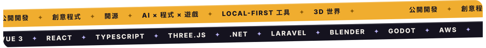
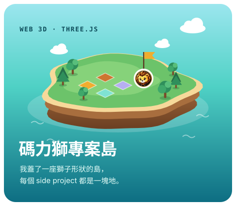
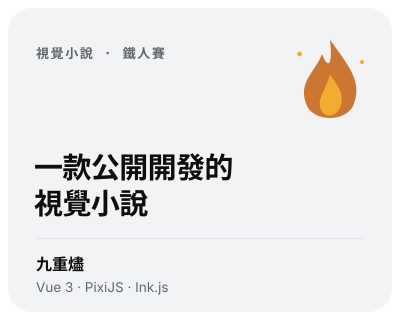
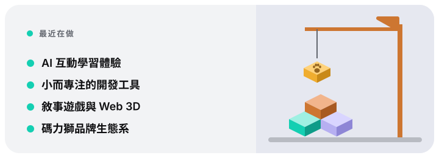
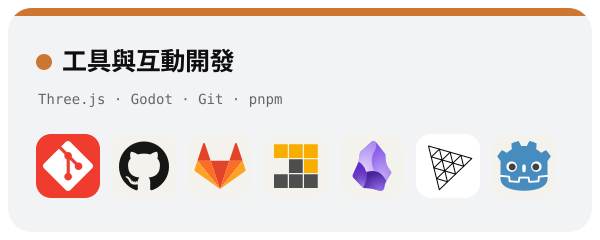
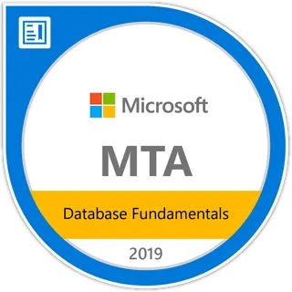

  <a href="https://github.com/malilion/malilion/blob/main/README.md">English</a> · <a href="https://github.com/malilion/malilion/blob/main/README.zh-TW.md">繁體中文</a>

<a href="https://malilion.com"><picture><source media="(prefers-color-scheme: dark)" srcset="./assets/brand/bento/hero-zh-dark.svg"></picture></a> 
<picture><source media="(prefers-color-scheme: dark)" srcset="./assets/brand/bento/ticker-zh-dark.svg"></picture> 
<a href="https://malilion.github.io/MalilionUI/"><picture><source media="(prefers-color-scheme: dark)" srcset="./assets/brand/bento/malilion-ui-zh-dark.svg"></picture></a><!--
--><a href="https://www.malilion.com/world"><picture><source media="(prefers-color-scheme: dark)" srcset="./assets/brand/bento/project-island-zh-dark.svg"></picture></a> 
<a href="https://github.com/malilion/ContextLion"><picture><source media="(prefers-color-scheme: dark)" srcset="./assets/brand/bento/contextlion-zh-dark.svg"></picture></a><!--
--><a href="https://ithelp.ithome.com.tw/users/20183394/ironman/9059"><picture><source media="(prefers-color-scheme: dark)" srcset="./assets/brand/bento/ninefold-court-zh-dark.svg"></picture></a><!--
--><a href="https://github.com/malilion/cow-pasture"><picture><source media="(prefers-color-scheme: dark)" srcset="./assets/brand/bento/cow-pasture-zh-dark.svg"></picture></a> 
<a href="https://malilion.com"><picture><source media="(prefers-color-scheme: dark)" srcset="./assets/brand/bento/now-building-zh-dark.svg"></picture></a><!--
--><a href="https://www.threads.com/@malilion.dev"><picture><source media="(prefers-color-scheme: dark)" srcset="./assets/brand/bento/threads-zh-dark.svg"></picture></a>

  
  
  
   
  <a href="https://malilion.github.io/MalilionUI/"><b>Malilion UI 文件</b></a> · <a href="https://www.youtube.com/watch?v=ElXvObJbIFY"><b>預告片</b></a> · <a href="https://malilion.com"><b>malilion.com</b></a> · <a href="https://www.threads.com/@malilion.dev"><b>Threads</b></a>

## 其他作品

<table>
<tr>
<td width="33%" valign="top">
<b>AI 與開發工具</b>  
<a href="https://github.com/malilion/DevTraceLion"><b>DevTrace Lion</b></a> 在 DevTools 內做 Local-first API 除錯，不需任何權限  
<a href="https://github.com/malilion/editorial-photo-poster"><b>Editorial Photo Poster</b></a> Codex skill：照片轉成簡約編輯風海報  
<a href="https://github.com/malilion/haute-jewelry-from-photo"><b>Haute Jewelry From Photo</b></a> Codex skill：圖片氛圍轉成高級珠寶概念  
<a href="https://github.com/malilion/scenic-bookmark-travel-poster"><b>Scenic Bookmark Travel Poster</b></a> Codex skill：旅遊照片轉成日系紀念海報與書籤  
</td>
<td width="33%" valign="top">
<b>互動世界</b>  
<a href="https://github.com/malilion/The-Nocturne-Atlas"><b>The Nocturne Atlas</b></a> 由種子驅動的 3D 魔法世界，Three.js + TypeScript  
<a href="https://github.com/malilion/Painterly-Meadow"><b>風之草原 Painterly Meadow</b></a> 單一 Three.js 檔案的手繪風 NPR 自然沙盒  
<a href="https://github.com/malilion/fuji-sakura-vista"><b>Fuji Sakura Vista</b></a> Blender 程式生成的富士山黎明場景，附 Three.js 展示  
</td>
<td width="33%" valign="top">
<b>設計與創意程式</b>  
<a href="https://malilion.github.io/BlockUI/"><b>BlockUI</b></a> 像素合成遊戲風 React 元件庫，五種主題，WCAG 2.2 AA  
<a href="https://github.com/malilion/lyricreel"><b>lyricreel</b></a> 輸入歌曲與歌詞，輸出跟著節拍走的歌詞 MV  
<a href="https://github.com/malilion/riso-mv-kit"><b>riso-mv-kit</b></a> 用程式繪製的 Riso 印刷風繪本 MV  
<a href="https://github.com/malilion/oledfx"><b>oledfx</b></a> · <a href="https://github.com/malilion/inkfx"><b>inkfx</b></a> · <a href="https://github.com/malilion/fx-skill-kit"><b>fx-skill-kit</b></a> 以程式生成視覺特效的 FX 工具組  
</td>
</tr>
</table>

<a href="https://github.com/malilion?tab=repositories"><b>看全部 repo →</b></a> · <a href="https://malilion.com"><b>更多內容在 malilion.com →</b></a>

## 技術棧

<picture><source media="(prefers-color-scheme: dark)" srcset="./assets/brand/bento/stack-core-zh-dark.svg"></picture><!--
--><picture><source media="(prefers-color-scheme: dark)" srcset="https://skillicons.dev/icons?i=html,css,js,ts,php,cs,dotnet"></picture> 
<picture><source media="(prefers-color-scheme: dark)" srcset="./assets/brand/bento/stack-frontend-zh-dark.svg"></picture><!--
--><picture><source media="(prefers-color-scheme: dark)" srcset="https://skillicons.dev/icons?i=laravel,vue,react,nextjs,vite,pinia,tailwind"></picture> 
<picture><source media="(prefers-color-scheme: dark)" srcset="./assets/brand/bento/stack-cloud-zh-dark.svg"></picture><!--
--><picture><source media="(prefers-color-scheme: dark)" srcset="https://skillicons.dev/icons?i=aws,docker,vercel,cloudflare,supabase,postgres,mysql"></picture> 
<picture><source media="(prefers-color-scheme: dark)" srcset="./assets/brand/bento/stack-tools-zh-dark.svg"></picture><!--
--><picture><source media="(prefers-color-scheme: dark)" srcset="https://skillicons.dev/icons?i=git,github,gitlab,pnpm,obsidian,threejs,godot"></picture>

  <picture>
    <source media="(prefers-color-scheme: dark)" srcset="https://raw.githubusercontent.com/malilion/malilion/gh-pages/paw-heatmap-dark-zh.svg">
    <source media="(prefers-color-scheme: light)" srcset="https://raw.githubusercontent.com/malilion/malilion/gh-pages/paw-heatmap-light-zh.svg">
    
  </picture>

<b>工作經歷與證照</b>

 

| 時間 | 角色 | 主要方向 |
| --- | --- | --- |
| 2023 | 軟體工程師 · 新創公司 | Laravel、MySQL、REST API、Docker、企業內部系統 |
| 2024～2026 | 軟體工程師 · 工業電腦公司 | ASP.NET Core、Vue.js、MSSQL / Oracle、系統架構、內部平台 |
| 2026～現在 | 軟體工程師 · 科技業 | Vue.js、.NET Core API、企業應用、系統架構與團隊開發規範 |

> 我最在意的是把真實營運問題轉成可維護的系統，再把工作中學到的東西延伸到 Side Project 與開源作品。

<table>
  <tr>
    <td align="center" width="180"> <b>AWS Certified Cloud Practitioner</b></td>
    <td align="center" width="180"> <b>AWS Certified AI Practitioner</b></td>
    <td align="center" width="180"> <b>MTA Database Fundamentals</b></td>
    <td align="center" width="180"> <b>MTA Networking Fundamentals</b></td>
    <td align="center" width="180"> <b>MTA Software Development Fundamentals</b></td>
  </tr>
</table>

<b>GitHub 統計</b>

 

  <picture>
    <source media="(prefers-color-scheme: dark)" srcset="https://raw.githubusercontent.com/malilion/malilion/gh-pages/stats-dark-zh.svg">
    <source media="(prefers-color-scheme: light)" srcset="https://raw.githubusercontent.com/malilion/malilion/gh-pages/stats-light-zh.svg">
    
  </picture>

  <picture>
    <source media="(prefers-color-scheme: dark)" srcset="https://raw.githubusercontent.com/malilion/malilion/gh-pages/streak-dark-zh.svg">
    <source media="(prefers-color-scheme: light)" srcset="https://raw.githubusercontent.com/malilion/malilion/gh-pages/streak-light-zh.svg">
    
  </picture>
  <picture>
    <source media="(prefers-color-scheme: dark)" srcset="https://raw.githubusercontent.com/malilion/malilion/gh-pages/languages-dark-zh.svg">
    <source media="(prefers-color-scheme: light)" srcset="https://raw.githubusercontent.com/malilion/malilion/gh-pages/languages-light-zh.svg">
    
  </picture>

  <picture>
    <source media="(prefers-color-scheme: dark)" srcset="https://raw.githubusercontent.com/malilion/malilion/gh-pages/monthly-dark-zh.svg">
    <source media="(prefers-color-scheme: light)" srcset="https://raw.githubusercontent.com/malilion/malilion/gh-pages/monthly-light-zh.svg">
    
  </picture>

   
  <b>Build → Learn → Share → Build again.</b>

