

  <a href="https://github.com/malilion/malilion/blob/main/README.md">English</a> · <a href="https://github.com/malilion/malilion/blob/main/README.zh-TW.md">繁體中文</a>

<a href="https://malilion.com"><picture><source media="(max-width: 600px) and (prefers-color-scheme: dark)" srcset="./assets/brand/bento/hero-m-zh-dark.svg"><source media="(max-width: 600px)" srcset="./assets/brand/bento/hero-m-zh-light.svg"><source media="(prefers-color-scheme: dark)" srcset="./assets/brand/bento/hero-zh-dark.svg"></picture></a> 
<picture><source media="(max-width: 600px) and (prefers-color-scheme: dark)" srcset="./assets/brand/bento/ticker-m-zh-dark.svg"><source media="(max-width: 600px)" srcset="./assets/brand/bento/ticker-m-zh-light.svg"><source media="(prefers-color-scheme: dark)" srcset="./assets/brand/bento/ticker-zh-dark.svg"></picture> 
<a href="https://malilion.github.io/MalilionUI/"><picture><source media="(max-width: 600px) and (prefers-color-scheme: dark)" srcset="./assets/brand/bento/malilion-ui-m-zh-dark.svg"><source media="(max-width: 600px)" srcset="./assets/brand/bento/malilion-ui-m-zh-light.svg"><source media="(prefers-color-scheme: dark)" srcset="./assets/brand/bento/malilion-ui-zh-dark.svg">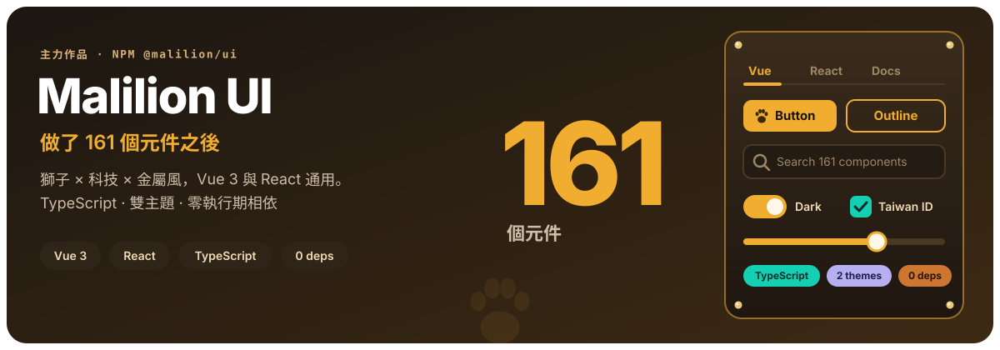</picture></a><!--
--><a href="https://www.malilion.com/world"><picture><source media="(max-width: 600px) and (prefers-color-scheme: dark)" srcset="./assets/brand/bento/project-island-m-zh-dark.svg"><source media="(max-width: 600px)" srcset="./assets/brand/bento/project-island-m-zh-light.svg"><source media="(prefers-color-scheme: dark)" srcset="./assets/brand/bento/project-island-zh-dark.svg"></picture></a> 
<a href="https://github.com/malilion/ContextLion"><picture><source media="(max-width: 600px) and (prefers-color-scheme: dark)" srcset="./assets/brand/bento/contextlion-m-zh-dark.svg"><source media="(max-width: 600px)" srcset="./assets/brand/bento/contextlion-m-zh-light.svg"><source media="(prefers-color-scheme: dark)" srcset="./assets/brand/bento/contextlion-zh-dark.svg">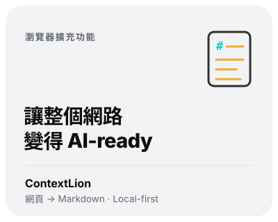</picture></a><!--
--><a href="https://ithelp.ithome.com.tw/users/20183394/ironman/9059"><picture><source media="(max-width: 600px) and (prefers-color-scheme: dark)" srcset="./assets/brand/bento/ninefold-court-m-zh-dark.svg"><source media="(max-width: 600px)" srcset="./assets/brand/bento/ninefold-court-m-zh-light.svg"><source media="(prefers-color-scheme: dark)" srcset="./assets/brand/bento/ninefold-court-zh-dark.svg"></picture></a><!--
--><a href="https://github.com/malilion/cow-pasture"><picture><source media="(max-width: 600px) and (prefers-color-scheme: dark)" srcset="./assets/brand/bento/cow-pasture-m-zh-dark.svg"><source media="(max-width: 600px)" srcset="./assets/brand/bento/cow-pasture-m-zh-light.svg"><source media="(prefers-color-scheme: dark)" srcset="./assets/brand/bento/cow-pasture-zh-dark.svg">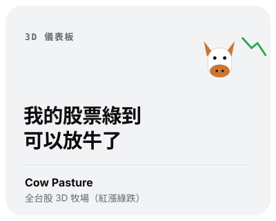</picture></a> 
<a href="https://malilion.com"><picture><source media="(max-width: 600px) and (prefers-color-scheme: dark)" srcset="./assets/brand/bento/now-building-m-zh-dark.svg"><source media="(max-width: 600px)" srcset="./assets/brand/bento/now-building-m-zh-light.svg"><source media="(prefers-color-scheme: dark)" srcset="./assets/brand/bento/now-building-zh-dark.svg"></picture></a><!--
--><a href="https://www.threads.com/@malilion.dev"><picture><source media="(max-width: 600px) and (prefers-color-scheme: dark)" srcset="./assets/brand/bento/threads-m-zh-dark.svg"><source media="(max-width: 600px)" srcset="./assets/brand/bento/threads-m-zh-light.svg"><source media="(prefers-color-scheme: dark)" srcset="./assets/brand/bento/threads-zh-dark.svg">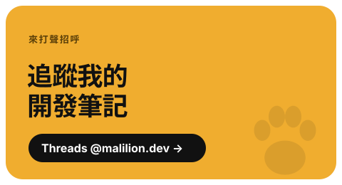</picture></a>

  
  
  
   
  <a href="https://malilion.github.io/MalilionUI/"><b>Malilion UI 文件</b></a> · <a href="https://www.youtube.com/watch?v=ElXvObJbIFY"><b>預告片</b></a> · <a href="https://malilion.com"><b>malilion.com</b></a> · <a href="https://www.threads.com/@malilion.dev"><b>Threads</b></a>

## 其他作品

<table>
<tr>
<td width="50%" valign="top">
<picture><source media="(prefers-color-scheme: dark)" srcset="./assets/brand/bento/cat-ai-tools-zh-dark.svg"></picture>  
<a href="https://github.com/malilion/AURA-REC"><b>AURA REC</b></a> · <a href="https://malilion.github.io/AURA-REC/">↗ 網站</a> 免費開源、隱私優先的螢幕錄影與教學剪輯工具，macOS、Windows 和瀏覽器都能用  
<a href="https://github.com/malilion/StockLion"><b>StockLion 股力獅</b></a> 瀏覽器擴充功能：在任何網頁看台股報價與自選清單  
<a href="https://github.com/malilion/Malilion-AI-Radar"><b>Malilion AI Radar</b></a> · <a href="https://malilion.github.io/Malilion-AI-Radar/">↗ 網站</a> 每小時自動更新的新聞與 AI 情報網站  
<a href="https://github.com/malilion/DevTraceLion"><b>DevTrace Lion</b></a> 在 DevTools 內做 Local-first API 除錯，不需任何權限  
<a href="https://github.com/malilion/github-repo-landing-page-skill"><b>GitHub Repo Landing Page Skill</b></a> · <a href="https://malilion.github.io/github-repo-landing-page-skill/">↗ 網站</a> 把任何 GitHub repo 變成形象頁的 agent skill  
<a href="https://github.com/malilion/editorial-photo-poster"><b>Editorial Photo Poster</b></a> · <a href="https://github.com/malilion/haute-jewelry-from-photo"><b>Haute Jewelry From Photo</b></a> · <a href="https://github.com/malilion/scenic-bookmark-travel-poster"><b>Scenic Bookmark Travel Poster</b></a> Codex skills：照片轉成海報、珠寶概念與書籤  
</td>
<td width="50%" valign="top">
<picture><source media="(prefers-color-scheme: dark)" srcset="./assets/brand/bento/cat-games-zh-dark.svg">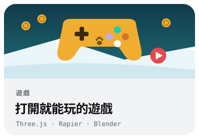</picture>  
<a href="https://github.com/malilion/Snowboarding"><b>POWDER RUSH 粉雪狂飆</b></a> · <a href="https://malilion.github.io/Snowboarding/">▶ 試玩</a> 單板滑雪 3D 動作遊戲：3,200 公尺賽道、18 個跳台  
<a href="https://github.com/malilion/neon-taipei-overdrive"><b>Neon Taipei Overdrive</b></a> · <a href="https://malilion.github.io/neon-taipei-overdrive/">▶ 試玩</a> 雨夜台北的賽博龐克動作遊戲，只有一個 HTML 檔  
<a href="https://github.com/malilion/shuangyue-wenjian"><b>霜月問劍</b></a> · <a href="https://malilion.github.io/shuangyue-wenjian/">▶ 試玩</a> 俯視角武俠動作，三關，每關有兩階段 Boss  
<a href="https://github.com/malilion/prachute"><b>Cloud Dive 雲海跳傘</b></a> · <a href="https://malilion.github.io/prachute/">▶ 試玩</a> 從 4,000 公尺穿越金色雲海，降落在靶心  
<a href="https://github.com/malilion/star-garden-rumble"><b>Star Garden Rumble</b></a> · <a href="https://malilion.github.io/star-garden-rumble/">▶ 試玩</a> 浮島上的低面數 3D 物理防守遊戲（Rapier）  
<a href="https://github.com/malilion/Polar-Bear-BBQ-Game"><b>Polar Bear BBQ 3D</b></a> · <a href="https://malilion.github.io/Polar-Bear-BBQ-Game/">▶ 試玩</a> Blender 建模、Three.js 呈現的北極熊烤肉店  
</td>
</tr>
<tr>
<td width="50%" valign="top">
<picture><source media="(prefers-color-scheme: dark)" srcset="./assets/brand/bento/cat-worlds-zh-dark.svg">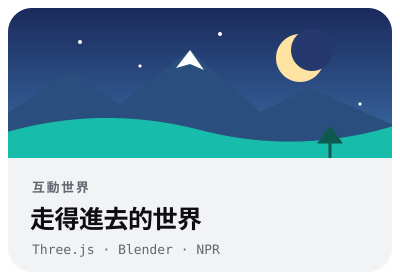</picture>  
<a href="https://github.com/malilion/The-Nocturne-Atlas"><b>The Nocturne Atlas</b></a> 由種子驅動的 3D 魔法世界，Three.js + TypeScript  
<a href="https://github.com/malilion/Painterly-Meadow"><b>風之草原 Painterly Meadow</b></a> 單一 Three.js 檔案的手繪風 NPR 自然沙盒  
<a href="https://github.com/malilion/fuji-sakura-vista"><b>Fuji Sakura Vista</b></a> Blender 程式生成的富士山黎明場景，附 Three.js 展示  
<a href="https://github.com/malilion/bee_scene"><b>Realistic Bee & Flowers</b></a> · <a href="https://malilion.github.io/bee_scene/">↗ 網站</a> 蜜蜂在草原採花的互動 3D 場景，單一離線 HTML 檔  
</td>
<td width="50%" valign="top">
<picture><source media="(prefers-color-scheme: dark)" srcset="./assets/brand/bento/cat-creative-zh-dark.svg">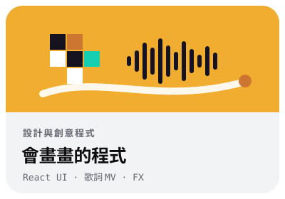</picture>  
<a href="https://malilion.github.io/BlockUI/"><b>BlockUI</b></a> 像素合成遊戲風 React 元件庫，五種主題，WCAG 2.2 AA  
<a href="https://github.com/malilion/my-bear-jelly"><b>Gummy/Bears.</b></a> · <a href="https://malilion.github.io/my-bear-jelly/">↗ 網站</a> 會晃動的軟糖熊，每個像素都由 shader 算出  
<a href="https://github.com/malilion/lyricreel"><b>lyricreel</b></a> 輸入歌曲與歌詞，輸出跟著節拍走的歌詞 MV  
<a href="https://github.com/malilion/riso-mv-kit"><b>riso-mv-kit</b></a> 用程式繪製的 Riso 印刷風繪本 MV  
<a href="https://github.com/malilion/oledfx"><b>oledfx</b></a> · <a href="https://github.com/malilion/inkfx"><b>inkfx</b></a> · <a href="https://github.com/malilion/fx-skill-kit"><b>fx-skill-kit</b></a> 以程式生成視覺特效的 FX 工具組  
</td>
</tr>
</table>

<a href="https://github.com/malilion?tab=repositories"><b>看全部 repo →</b></a> · <a href="https://malilion.com"><b>更多內容在 malilion.com →</b></a>

## 技術棧

<picture><source media="(prefers-color-scheme: dark)" srcset="./assets/brand/bento/stack-core-zh-dark.svg">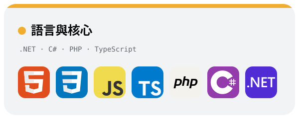</picture><!--
--><picture><source media="(prefers-color-scheme: dark)" srcset="https://skillicons.dev/icons?i=html%2Ccss%2Cjs%2Cts%2Cphp%2Ccs%2Cdotnet&theme=dark"></picture> 
<picture><source media="(prefers-color-scheme: dark)" srcset="./assets/brand/bento/stack-frontend-zh-dark.svg">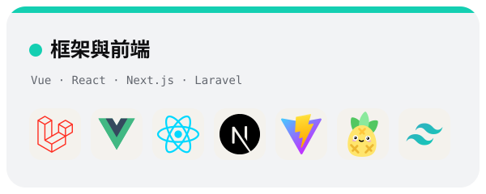</picture><!--
--><picture><source media="(prefers-color-scheme: dark)" srcset="https://skillicons.dev/icons?i=laravel%2Cvue%2Creact%2Cnextjs%2Cvite%2Cpinia%2Ctailwind&theme=dark"></picture> 
<picture><source media="(prefers-color-scheme: dark)" srcset="./assets/brand/bento/stack-cloud-zh-dark.svg">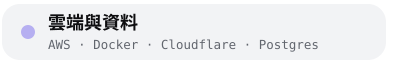</picture><!--
--><picture><source media="(prefers-color-scheme: dark)" srcset="https://skillicons.dev/icons?i=aws%2Cdocker%2Cvercel%2Ccloudflare%2Csupabase%2Cpostgres%2Cmysql&theme=dark"></picture> 
<picture><source media="(prefers-color-scheme: dark)" srcset="./assets/brand/bento/stack-tools-zh-dark.svg"></picture><!--
--><picture><source media="(prefers-color-scheme: dark)" srcset="https://skillicons.dev/icons?i=git%2Cgithub%2Cgitlab%2Cpnpm%2Cobsidian%2Cthreejs%2Cgodot&theme=dark"></picture>

## 經歷與證照

<picture><source media="(max-width: 600px) and (prefers-color-scheme: dark)" srcset="./assets/brand/bento/experience-m-zh-dark.svg"><source media="(max-width: 600px)" srcset="./assets/brand/bento/experience-m-zh-light.svg"><source media="(prefers-color-scheme: dark)" srcset="./assets/brand/bento/experience-zh-dark.svg">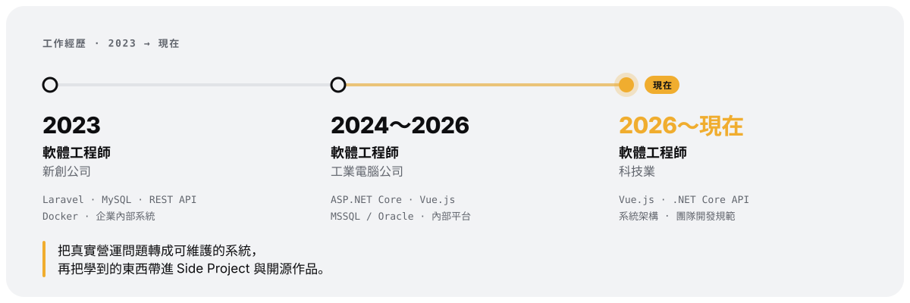</picture> 
<picture><source media="(max-width: 600px) and (prefers-color-scheme: dark)" srcset="./assets/brand/bento/certifications-m-zh-dark.svg"><source media="(max-width: 600px)" srcset="./assets/brand/bento/certifications-m-zh-light.svg"><source media="(prefers-color-scheme: dark)" srcset="./assets/brand/bento/certifications-zh-dark.svg">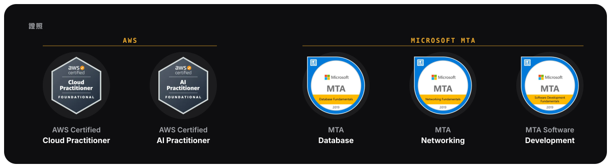</picture>

## GitHub 活動

<picture><source media="(max-width: 600px) and (prefers-color-scheme: dark)" srcset="https://raw.githubusercontent.com/malilion/malilion/gh-pages/activity-year-m-dark-zh.svg"><source media="(max-width: 600px)" srcset="https://raw.githubusercontent.com/malilion/malilion/gh-pages/activity-year-m-light-zh.svg"><source media="(prefers-color-scheme: dark)" srcset="https://raw.githubusercontent.com/malilion/malilion/gh-pages/activity-year-dark-zh.svg"></picture><!--
--><picture><source media="(max-width: 600px) and (prefers-color-scheme: dark)" srcset="https://raw.githubusercontent.com/malilion/malilion/gh-pages/activity-streak-m-dark-zh.svg"><source media="(max-width: 600px)" srcset="https://raw.githubusercontent.com/malilion/malilion/gh-pages/activity-streak-m-light-zh.svg"><source media="(prefers-color-scheme: dark)" srcset="https://raw.githubusercontent.com/malilion/malilion/gh-pages/activity-streak-dark-zh.svg"></picture><!--
--><picture><source media="(max-width: 600px) and (prefers-color-scheme: dark)" srcset="https://raw.githubusercontent.com/malilion/malilion/gh-pages/activity-languages-m-dark-zh.svg"><source media="(max-width: 600px)" srcset="https://raw.githubusercontent.com/malilion/malilion/gh-pages/activity-languages-m-light-zh.svg"><source media="(prefers-color-scheme: dark)" srcset="https://raw.githubusercontent.com/malilion/malilion/gh-pages/activity-languages-dark-zh.svg">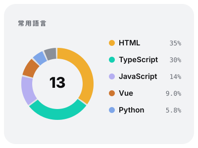</picture><!--
--><picture><source media="(max-width: 600px) and (prefers-color-scheme: dark)" srcset="https://raw.githubusercontent.com/malilion/malilion/gh-pages/activity-numbers-m-dark-zh.svg"><source media="(max-width: 600px)" srcset="https://raw.githubusercontent.com/malilion/malilion/gh-pages/activity-numbers-m-light-zh.svg"><source media="(prefers-color-scheme: dark)" srcset="https://raw.githubusercontent.com/malilion/malilion/gh-pages/activity-numbers-dark-zh.svg"></picture>

  <picture>
    <source media="(prefers-color-scheme: dark)" srcset="https://raw.githubusercontent.com/malilion/malilion/gh-pages/paw-heatmap-dark-zh.svg">
    <source media="(prefers-color-scheme: light)" srcset="https://raw.githubusercontent.com/malilion/malilion/gh-pages/paw-heatmap-light-zh.svg">
    
  </picture>

<a href="https://malilion.com"><picture><source media="(max-width: 600px) and (prefers-color-scheme: dark)" srcset="./assets/brand/bento/footer-m-zh-dark.svg"><source media="(max-width: 600px)" srcset="./assets/brand/bento/footer-m-zh-light.svg"><source media="(prefers-color-scheme: dark)" srcset="./assets/brand/bento/footer-zh-dark.svg"></picture></a>

  <a href="https://malilion.com"><b>malilion.com</b></a> · <a href="https://www.threads.com/@malilion.dev"><b>Threads</b></a> · <a href="https://github.com/malilion?tab=repositories"><b>全部 repo</b></a> · <a href="https://www.npmjs.com/package/@malilion/ui"><b>npm</b></a>

